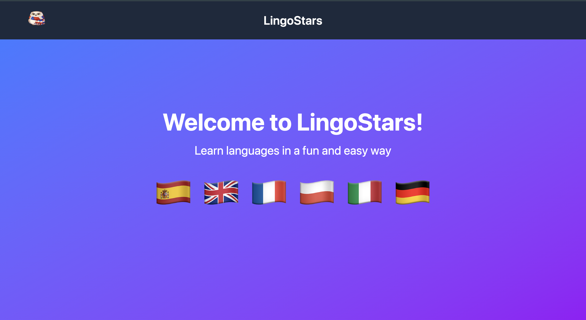
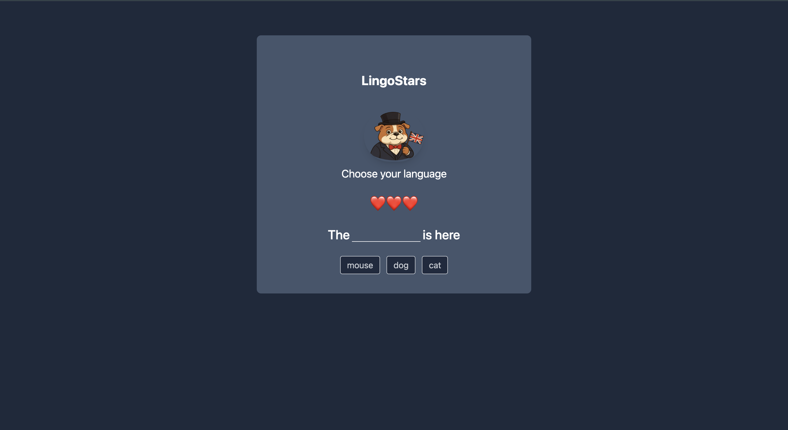

# LingoStars 🌍✨

LingoStars es una aplicación web interactiva de aprendizaje de idiomas desarrollada con Vue 3.  
Aprovecha el sistema de reactividad para actualizar progreso, vidas y niveles en tiempo real sin recargar la página.

La aplicación combina aprendizaje estructurado y gamificación para ofrecer una experiencia dinámica y motivadora.

---

## 🎯 Objetivo

Desarrollar una plataforma educativa interactiva que combine progresión estructurada, reactividad y recompensas digitales para mejorar la motivación en el aprendizaje de idiomas.

---

## 🌎 Idiomas Disponibles

- Español 🇪🇸
- Inglés 🇬🇧
- Polaco 🇵🇱
- Francés 🇫🇷
- Alemán 🇩🇪
- Italiano 🇮🇹

Cada idioma cuenta con su propia mascota y una ruta de aprendizaje independiente.

---

## 🌍 Sistema de Aprendizaje

- 5 niveles progresivos por idioma  
- 3 vidas por partida  
- 1 vida extra al completar un nivel  
- Si se pierden todas las vidas, el jugador debe tocar la mascota para volver al inicio (Home)  
- Desde el Home puede volver a entrar a cualquier idioma  
- Cada idioma guarda su progreso de forma independiente  
- Al completar los 5 niveles de un idioma se desbloquea y descarga automáticamente un trofeo oficial con su mascota  

---

## 💻 Arquitectura Técnica

- SPA (Single Page Application)  
- Reactividad en tiempo real gracias a Vue 3  
- Arquitectura basada en componentes  
- Sistema modular organizado por idioma  
- Gestión de progreso por ruta independiente  
- Interfaz limpia, intuitiva y responsive  

---

## 🛠 Tecnologías Utilizadas

- Vue 3  
- Vue Router  
- Vite  
- JavaScript  
- Tailwind CSS  

---

## 📸 Vista Previa

### 🏠 Pantalla Principal

### 🇬🇧 Ruta de Inglés

---

## 📦 Instalación

npm install

## 💻 Desarrollo

npm run dev

## 🏗 Build para Producción

npm run build